# Hot Drop — Wiki

> Généré par `npm run wiki` depuis les données du jeu : ne pas modifier à la main.

## Sommaire

1. [Le principe](#le-principe)
2. [Déroulé d’une partie](#déroulé-dune-partie)
3. [Le sac](#le-sac)
4. [Le combat](#le-combat)
5. [Les liens : étoiles et accessoires](#les-liens--étoiles-et-accessoires)
6. [Familles](#familles)
7. [Opérateurs](#opérateurs)
8. [Recettes](#recettes)
9. [Butin, caisses et boutique](#butin-caisses-et-boutique)
10. [Sacoches](#sacoches)
11. [Objets](#objets)

## Le principe

Un battle royale en solo, joué comme un *backpack battler* : on se largue sur une carte, on ramasse des objets, on les range dans un sac en grille, et les duels se jouent seuls à partir de ce que contient le sac.

Tout se décide **hors combat** : quoi prendre, quoi revendre, et surtout **où ranger chaque objet**, car les objets qui se touchent se renforcent (étoiles, accessoires, chargeurs, recettes).

Objectif : survivre aux 5 cercles puis gagner le duel final, le **Top 1**.

## Déroulé d’une partie

### La carte et le cercle

- La carte compte 9 zones de trois tailles (petite, moyenne, grande). Elle est grande au départ et le cercle de gaz se resserre à chaque manche : les zones gazées ne sont plus jouables.
- Une partie dure 5 manches (cercles). À chaque manche on choisit une zone dans le cercle et on s’y largue.
- Dans une zone, on tire des cartes (petite 4, moyenne 6, grande 8) et on en joue **3** : chaque carte jouée est une action.
- Après la dernière action, le cercle se resserre : **ravitaillement** (une boutique garantie), puis retour sur la carte pour la manche suivante.
- Après la 5ᵉ manche : ravitaillement, puis le duel final **Top 1** contre le bot le plus fort de la partie.

### Les cartes

| Carte | Effet |
|---|---|
| Duel | Un duel contre un bot. Victoire : crédits, puis on prend 1 objet dans son sac. |
| Élite | Un duel contre un bot fort. Victoire : plus de crédits, 2 objets à prendre dans son sac, 40 % de chance d’une sacoche. |
| Caisse | Quelques objets proposés, on en garde un, plus des crédits. |
| Caisse renforcée | Plus d’objets et de crédits, dont un ingrédient qui complète une recette commencée (à partir du cercle 2). |
| Caisse épique | Contient un objet assemblé. Seulement dans les grandes zones (50 % de chance par zone, à partir du cercle 2). |
| Boutique | Acheter, revendre, relancer les offres. |

Fréquence des cartes selon la taille de la zone (poids relatifs) :

| Zone | Duel | Élite | Caisse | Caisse renforcée | Boutique |
|---|---|---|---|---|---|
| petite | 38 | 6 | 30 | 6 | 20 |
| moyenne | 36 | 16 | 20 | 8 | 20 |
| grande | 34 | 28 | 12 | 6 | 13 |

Une zone contient toujours au moins un combat, au plus une boutique et une caisse renforcée. Plus la zone est grande, plus les bots sont dangereux… et plus le butin est riche.

### Thèmes de zone

Chaque zone a un thème : 50 % du butin (boutique, caisses, objets des bots) en vient.

| Thème | Oriente vers |
|---|---|
| Armurerie | Armes à feu et armes de mêlée |
| Hôpital | Soins et protections |
| Chantier | Explosifs et famille Démolition |
| Commissariat | Accessoires et munitions |
| Marché noir | Pas d’orientation, mais deux fois plus de boutiques |

### Duels, crédits et Goulag

- Chaque duel commence PV pleins. PV max à la manche *n* (1ʳᵉ = 0) : 300 + 150 × *n* (300, 450, 600, 750, 900, 1050 PV au Top 1). Les bots ont les mêmes PV.
- Crédits d’un duel gagné : 6 + 2 × manche ; Élite : 10 + 3 × manche.
- **Goulag** : la première défaite de la partie envoie au Goulag, un duel équitable PV pleins. Gagné, on revient en jeu ; perdu, c’est la fin. Une seule fois par partie.
- Une défaite sans Goulag disponible, ou au Top 1, termine la partie.

## Le sac

- La grille fait 9 × 8 cases. Le sac de base occupe le centre (5 × 4 cases) ; les **sacoches** posées autour ajoutent des cases utilisables.
- Chaque objet a une forme ; on peut le tourner par quarts de tour. Ses étoiles tournent avec lui.
- Réserve : 6 objets et 3 sacoches non posés. Seuls les objets posés dans le sac comptent en combat.
- Revente : 50 % du prix (au moins 1 crédit).
- Crédits de départ : 10.

## Le combat

Le duel se joue seul, sac contre sac, et dure en général 12 à 20 secondes.

- **Armes à feu** : tirent en continu. Précision de base 85 %. Critique de base 5 %, dégâts ×2.
- **Chargeurs** : les munitions sont infinies, mais une arme rechargée sans chargeur de son calibre posé contre elle recharge **2 fois plus lentement** (badge « RECH ×2 »). Chaque chargeur adjacent du bon calibre accélère encore la recharge.
- **Armure** : absorbe les dégâts avant les PV, sauf la part qui la perce.
- **Mêlée** : frappe pendant tout le duel, à côté des armes à feu. Dans un sac **sans aucune arme à feu**, elle frappe 1,5 fois plus vite (build Lame).
- **Saignement** : dégâts qui ignorent l'armure, versés peu à peu (35 % de la réserve par seconde).
- **Objets actifs** (grenades, fumigène, soins, taser, bandage…) : se déclenchent seuls, avec des charges et un délai.
- **Temps limite** : 90 s. Au-delà, gagne celui qui a la plus grande part de ses PV max.

## Les liens : étoiles et accessoires

Les objets se renforcent quand ils se touchent dans le sac (bords partagés). Tout lien se voit dans le sac :

- **Étoiles** : certains objets ont des étoiles sur des cases précises autour d’eux. Une étoile s’allume quand un objet du bon type occupe une de ses cases. Quand on tient un objet, les cases où il se lierait s’affichent en étoiles creuses, et les objets qu’il attend sont entourés en vert. Chaque objet posé affiche « ★ n », son nombre d’étoiles allumées.
- **Accessoires et chargeurs** : ils ont une étoile tout autour d’eux qui attend une arme compatible (calibre pour les chargeurs, arme longue pour la lunette et le bipied, arme courte pour le viseur holo).
- En boutique, en caisse et au butin : « ★ » signale un objet qui se lierait au sac, « ⚗ » un objet qui complète une recette.
- *Max* : au plus ce nombre d’objets comptent pour une même étoile.

### Toutes les étoiles

| Objet | Attend | Effet |
|---|---|---|
| 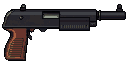 Pompe Sanglier | Explosif (tout autour) | +15 % de dégâts (max 2) |
|  Chargeur 9 mm | Arme 9mm (tout autour) | −25 % de recharge (max 3) |
|  Chargeur 5.56 | Arme 5.56 (tout autour) | −25 % de recharge (max 3) |
|  Chargeur 7.62 | Arme 7.62 (tout autour) | −25 % de recharge (max 3) |
| 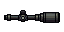 Lunette ×4 | Arme longue (tout autour) | +25 % de critique |
|  Silencieux | Arme (tout autour) | son 1er tir est critique |
| 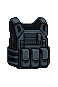 Plaque céramique | Protection (cases précises) | +8 d'armure (max 2) |
|  Casque balistique | Protection (cases précises) | +6 d'armure (max 1) |
| 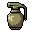 Grenade frag | Explosif (tout autour) | +20 % de dégâts (max 2) |
| 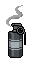 Fumigène | Explosif (tout autour) | +1 charge (max 1) |
|  Trousse IFAK | Protection (cases précises) | soins +20 % (max 1) |
| 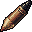 Munitions perforantes | Arme (tout autour) | perce 30 % de l'armure |
| 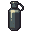 Grenade flash | Explosif (tout autour) | +1 charge (max 1) |
| 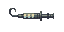 Seringue d'adrénaline | Arme (tout autour) | +10 % de cadence à cet objet (max 1) |
| 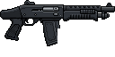 Pompe auto Bélier | Explosif (tout autour) | +15 % de dégâts (max 2) |
| 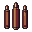 Cartouches 12G | Arme 12G (tout autour) | −25 % de recharge (max 3) |
| 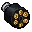 Balles .44 | Arme .44 (tout autour) | −25 % de recharge (max 3) |
| 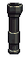 Poignée verticale | Arme (tout autour) | +25 % de cadence |
| 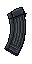 Chargeur étendu | Arme (tout autour) | chargeur +50 % |
| 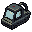 Viseur holo | Arme courte (tout autour) | +25 % de critique |
| 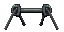 Bipied | Arme longue (tout autour) | +25 % de dégâts |
| 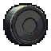 Chargeur tambour | Arme (tout autour) | chargeur +100 %, recharge +40 % (nourrit le Feu continu) |
| 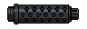 Refroidisseur de canon | Arme (tout autour) | son Feu continu monte 100 % plus vite (passif de Viper) |
| 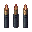 Munitions traçantes | Arme (tout autour) | quand elle consomme la Marque, +30 % de dégâts en plus (passif de Sentinelle) |
| 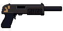 Pompe Dragon | Explosif (tout autour) | +15 % de dégâts (max 2) |
|  Grenade thermite | Arme (tout autour) | +10 % de dégâts à cet objet (max 1) |
| 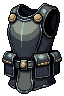 Armure lourde | Soin (tout autour) | soins +25 % à cet objet (max 2) |
| 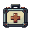 Kit de trauma | Protection (tout autour) | soins +30 % (max 1) |
|  Couteau | Arme de mêlée (cases précises) | +2 de saignement par coup (max 1) |
|  Couteau de combat | Arme de mêlée (cases précises) | +2 de saignement par coup (max 1) |
|  Masse | Protection (tout autour) | +25 % de dégâts (max 1) |
| 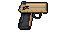 Taser | Arme de mêlée (tout autour) | +1 charge (max 1) |
|  Bandage | Protection (tout autour) | soins +50 % (max 1) |
|  Machette | Arme de mêlée (cases précises) | +25 % de dégâts (max 1) |
| 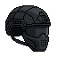 Casque lourd | Protection (cases précises) | +10 d'armure (max 1) |
|  Grenade à sous-munitions | Explosif (tout autour) | +1 charge (max 1) |
| 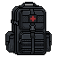 Sac médical | Soin (tout autour) | +1 charge à cet objet (max 2) |

## Familles

Chaque objet appartient à une famille. Avoir 2 puis 4 objets d’une famille posés dans le sac donne des bonus.

| Famille | 2 objets | 4 objets |
|---|---|---|
| Rafale | +15 % de cadence des armes Rafale | 1 balle sur 3 touche deux fois |
| Précision | +10 % de critique pour toutes les armes | Critiques ×2,25 au lieu de ×2 |
| Démolition | +1 charge pour chaque explosif | Explosions et fusils à pompe ignorent l'armure |
| Rempart | +20 % d'armure | L'armure se régénère de 2 par seconde |
| Tactique | Le fumigène dure 50 % plus longtemps | Prévu avec la radio et le drone |

## Opérateurs

On choisit un opérateur au début de la partie. Le pool d’objets est commun : chacun peut tout prendre, sauf les **objets de signature** de l’autre opérateur (et ce qui s’assemble avec eux).

### Viper

*Fusils d’assaut et SMG : noie l’ennemi sous les balles, sans lâcher la gâchette.*

- **Passif** : Feu continu : chaque arme gagne +5 % de cadence par seconde de tir sans recharger (max +30 %).
- **Famille** : Rafale.
- **Objets de signature** : Chargeur tambour, Refroidisseur de canon.
- **Sac de départ** : Casque balistique, Pistolet Mamba, Chargeur 9 mm, Refroidisseur de canon, Couteau.

### Sentinelle

*Fusils de précision et revolvers : une arme marque, l’autre achève.*

- **Passif** : Marque : un critique marque l’ennemi, la touche suivante d’une autre arme fait +50 %.
- **Famille** : Précision.
- **Objets de signature** : Munitions traçantes.
- **Sac de départ** : Casque balistique, Revolver Taureau, Balles .44, Poignée verticale, Couteau.

Détails des passifs : Feu continu +5 % de cadence par seconde de tir sans recharger, plafonné à +30 % ; Marque +50 % de dégâts sur la touche suivante d’une autre arme.

## Recettes

Quand tous les ingrédients d’une recette sont **posés dans le sac et se touchent** (en un seul bloc), ils s’assemblent automatiquement hors combat en un objet plus fort. Les objets assemblés ne se trouvent jamais au butin ni en boutique (sauf caisse épique).

| Ingrédients | Résultat |
|---|---|
| 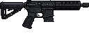 Fusil d'assaut KR-4 +  Poignée verticale +  Chargeur étendu | 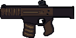 **KR-4 Tactique** |
| 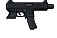 SMG Furet + 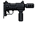 Pistolet-mitrailleur Guêpe | 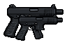 **Furet Akimbo** |
| 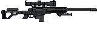 Fusil de précision Aigle +  Lunette ×4 +  Bipied | 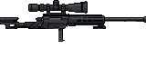 **Aigle Longue-vue** |
| 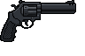 Revolver Taureau +  Balles .44 +  Silencieux | 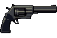 **Taureau Magnum** |
| 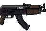 SMG lourd Ours +  Chargeur tambour | 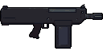 **Ours Déluge** |
| 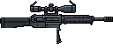 DMR Faucon +  Munitions traçantes | 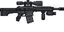 **Faucon Traqueur** |
|  Pompe Sanglier +  Cartouches 12G |  **Pompe Dragon** |
|  Grenade frag +  Fumigène |  **Grenade thermite** |
|  Plaque céramique +  Casque balistique |  **Armure lourde** |
|  Trousse IFAK +  Seringue d'adrénaline |  **Kit de trauma** |
| 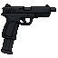 Pistolet Mamba +  Pistolet Mamba | 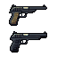 **Mamba Akimbo** |
|  Revolver Taureau +  Revolver Taureau | 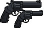 **Taureau Jumeaux** |
|  Casque balistique +  Casque balistique |  **Casque lourd** |
|  Grenade frag +  Grenade frag |  **Grenade à sous-munitions** |
|  Trousse IFAK +  Trousse IFAK |  **Sac médical** |
|  Couteau +  Couteau |  **Machette** |

## Butin, caisses et boutique

| Caisse | Objets proposés | À garder | Crédits (manche *n*) | Chance de sacoche |
|---|---|---|---|---|
| Caisse | 3 | 1 | 3 + 1 × *n* | 30 % |
| Caisse renforcée | 4 | 2 | 6 + 2 × *n* | 60 % |
| Caisse épique | 5 | 2 | 10 + 3 × *n* | 50 % |

Une caisse propose toujours au moins une arme.

- **Boutique** : 5 offres, 40 % de chance que l’une soit une sacoche. Relance : 2 crédits.
- **Répartition du butin** par catégorie : Arme 20 %, Munition 25 %, Accessoire 22 %, Protection 12 %, Explosif 11 %, Médical 10 %.
- Certains objets n’apparaissent qu’à partir d’un certain cercle (colonne « Dès » des tableaux d’objets).

## Sacoches

Posées sur la grille à côté du sac de base, elles ajoutent des cases. Les grandes deviennent plus fréquentes en fin de partie.

| Sacoche | Forme | Prix |
|---|---|---|
| Pochette | `■■` | 4 |
| Sacoche | `■■ / ■■` | 8 |
| Ceinture | `■■■■` | 8 |
| Sac tactique | `■■ / ■■ / ■■` | 13 |

## Objets

Formes : ■ = case occupée, · = case vide, lignes séparées par « / » (avant rotation).

### Armes à feu

#### Pistolet Mamba

**Base · Pistolet · 9mm** · Forme `■■ / ■·` (3 cases) · Prix 4 · dès le cercle 1

- Dégâts 11 toutes les 0,9 s
- Chargeur 8 balles · recharge 2 s
- Alimentation : un chargeur 9mm adjacent, sinon recharge ×2
- Recette : Mamba + Mamba → Mamba Akimbo (ingrédients adjacents : assemblage automatique)
- Famille Rafale : 2 → +15 % de cadence des armes rafale · 4 → 1 balle sur 3 touche deux fois
- 3 cases · revente 2 cr

#### SMG Furet

**Base · SMG · 9mm** · Forme `■■■ / ·■·` (4 cases) · Prix 6 · dès le cercle 1

- Dégâts 4,5 toutes les 0,4 s
- Chargeur 15 balles · recharge 2,5 s
- Alimentation : un chargeur 9mm adjacent, sinon recharge ×2
- Recette : Furet + Guêpe → Furet Akimbo (ingrédients adjacents : assemblage automatique)
- Famille Rafale : 2 → +15 % de cadence des armes rafale · 4 → 1 balle sur 3 touche deux fois
- 4 cases · revente 3 cr

#### Fusil d'assaut KR-4

**Base · Fusil d'assaut · 5.56** · Forme `■■■■ / ·■··` (5 cases) · Prix 8 · dès le cercle 1

- Dégâts 10 toutes les 0,7 s
- Chargeur 15 balles · recharge 2,5 s
- Alimentation : un chargeur 5.56 adjacent, sinon recharge ×2
- Recette : KR-4 + Poignée + Étendu → KR-4 Tactique (ingrédients adjacents : assemblage automatique)
- Famille Rafale : 2 → +15 % de cadence des armes rafale · 4 → 1 balle sur 3 touche deux fois
- 5 cases · revente 4 cr

#### Pompe Sanglier

**Base · Fusil à pompe · 12G** · Forme `■■■■ / ■···` (5 cases) · Prix 8 · dès le cercle 1

- Dégâts 18,5 toutes les 1,5 s
- Chargeur 4 balles · recharge 3 s
- Alimentation : un chargeur 12G adjacent, sinon recharge ×2
- Plombs : chaque tir touche 2 fois
- ★ Explosif adjacent : +15 % de dégâts
- Recette : Sanglier + Cart. 12G → Pompe Dragon (ingrédients adjacents : assemblage automatique)
- Famille Démolition : 2 → +1 charge pour chaque explosif · 4 → explosions et fusils à pompe ignorent l'armure
- 5 cases · revente 4 cr

#### Fusil de précision Aigle

**Base · Fusil de précision · 7.62** · Forme `■■■■■ / ··■··` (6 cases) · Prix 14 · dès le cercle 2

- Dégâts 51,5 toutes les 3 s
- Chargeur 4 balles · recharge 3,5 s
- Alimentation : un chargeur 7.62 adjacent, sinon recharge ×2
- Recette : Aigle + Lunette + Bipied → Aigle Longue-vue (ingrédients adjacents : assemblage automatique)
- Famille Précision : 2 → +10 % de critique pour toutes les armes · 4 → critiques ×2,25 au lieu de ×2
- 6 cases · revente 7 cr

#### Bullpup Vesta

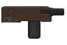

**Base · Fusil d'assaut · 5.56** · Forme `■■■ / ·■·` (4 cases) · Prix 8 · dès le cercle 1

- Dégâts 7,5 toutes les 0,6 s
- Chargeur 15 balles · recharge 2,2 s
- Alimentation : un chargeur 5.56 adjacent, sinon recharge ×2
- Famille Rafale : 2 → +15 % de cadence des armes rafale · 4 → 1 balle sur 3 touche deux fois
- 4 cases · revente 4 cr

#### Fusil de combat Hadès

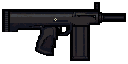

**Base · Fusil d'assaut · 5.56** · Forme `■■■■ / ·■■·` (6 cases) · Prix 10 · dès le cercle 1

- Dégâts 18 toutes les 1,1 s
- Chargeur 10 balles · recharge 3 s
- Alimentation : un chargeur 5.56 adjacent, sinon recharge ×2
- Famille Rafale : 2 → +15 % de cadence des armes rafale · 4 → 1 balle sur 3 touche deux fois
- 6 cases · revente 5 cr

#### Carabine Lynx

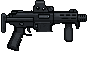

**Base · Fusil d'assaut · 5.56** · Forme `■■■ / ··■` (4 cases) · Prix 7 · dès le cercle 1

- Dégâts 6 toutes les 0,5 s
- Chargeur 12 balles · recharge 1,8 s
- Alimentation : un chargeur 5.56 adjacent, sinon recharge ×2
- Famille Rafale : 2 → +15 % de cadence des armes rafale · 4 → 1 balle sur 3 touche deux fois
- 4 cases · revente 3 cr

#### Pistolet-mitrailleur Guêpe

**Base · SMG · 9mm** · Forme `■■ / ·■` (3 cases) · Prix 5 · dès le cercle 1

- Dégâts 3 toutes les 0,3 s
- Chargeur 12 balles · recharge 1,8 s
- Alimentation : un chargeur 9mm adjacent, sinon recharge ×2
- Recette : Furet + Guêpe → Furet Akimbo (ingrédients adjacents : assemblage automatique)
- Famille Rafale : 2 → +15 % de cadence des armes rafale · 4 → 1 balle sur 3 touche deux fois
- 3 cases · revente 2 cr

#### SMG lourd Ours

**Base · SMG · 9mm** · Forme `■■■ / ■■·` (5 cases) · Prix 8 · dès le cercle 1

- Dégâts 6 toutes les 0,5 s
- Chargeur 18 balles · recharge 2,6 s
- Alimentation : un chargeur 9mm adjacent, sinon recharge ×2
- Recette : Ours + Tambour → Ours Déluge (ingrédients adjacents : assemblage automatique)
- Famille Rafale : 2 → +15 % de cadence des armes rafale · 4 → 1 balle sur 3 touche deux fois
- 5 cases · revente 4 cr

#### Revolver Taureau

**Base · Pistolet · .44** · Forme `■■■ / ■··` (4 cases) · Prix 7 · dès le cercle 1

- Dégâts 19 toutes les 1,4 s
- Chargeur 4 balles · recharge 2,4 s
- Alimentation : un chargeur .44 adjacent, sinon recharge ×2
- Recette : Taureau + Balles .44 + Silenc. → Taureau Magnum (ingrédients adjacents : assemblage automatique)
- Recette : Taureau + Taureau → Taureau Jumeaux (ingrédients adjacents : assemblage automatique)
- Famille Précision : 2 → +10 % de critique pour toutes les armes · 4 → critiques ×2,25 au lieu de ×2
- 4 cases · revente 3 cr

#### Pompe auto Bélier

**Base · Fusil à pompe · 12G** · Forme `■■■■ / ■■··` (6 cases) · Prix 12 · dès le cercle 2

- Dégâts 13 toutes les 1 s
- Chargeur 4 balles · recharge 3,2 s
- Alimentation : un chargeur 12G adjacent, sinon recharge ×2
- Plombs : chaque tir touche 2 fois
- ★ Explosif adjacent : +15 % de dégâts
- Famille Démolition : 2 → +1 charge pour chaque explosif · 4 → explosions et fusils à pompe ignorent l'armure
- 6 cases · revente 6 cr

#### DMR Faucon

**Base · Fusil de précision · 7.62** · Forme `■■■■ / ··■·` (5 cases) · Prix 10 · dès le cercle 1

- Dégâts 35,5 toutes les 1,6 s
- Chargeur 5 balles · recharge 3 s
- Alimentation : un chargeur 7.62 adjacent, sinon recharge ×2
- Recette : Faucon + Traçantes → Faucon Traqueur (ingrédients adjacents : assemblage automatique)
- Famille Précision : 2 → +10 % de critique pour toutes les armes · 4 → critiques ×2,25 au lieu de ×2
- 5 cases · revente 5 cr

#### Pistolet de poche Colibri

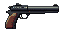

**Base · Pistolet · .44** · Forme `■■` (2 cases) · Prix 5 · dès le cercle 1

- Dégâts 8,5 toutes les 0,8 s
- Chargeur 6 balles · recharge 1,8 s
- Alimentation : un chargeur .44 adjacent, sinon recharge ×2
- +20 % de critique
- Famille Précision : 2 → +10 % de critique pour toutes les armes · 4 → critiques ×2,25 au lieu de ×2
- 2 cases · revente 2 cr

### Armes à feu assemblées

#### KR-4 Tactique

**Assemblé · Fusil d'assaut · 5.56** · Forme `■■■■ / ·■■·` (6 cases) · Assemblé

- Dégâts 11 toutes les 0,6 s
- Chargeur 22 balles · recharge 2,2 s
- Alimentation : n'importe quel chargeur adjacent, sinon recharge ×2
- Objet assemblé (recette)
- Famille Rafale : 2 → +15 % de cadence des armes rafale · 4 → 1 balle sur 3 touche deux fois
- 6 cases · revente 9 cr

#### Furet Akimbo

**Assemblé · SMG · 9mm** · Forme `■■■ / ■■■` (6 cases) · Assemblé

- Dégâts 4,5 toutes les 0,4 s
- Chargeur 24 balles · recharge 2,6 s
- Alimentation : un chargeur 9mm adjacent, sinon recharge ×2
- Plombs : chaque tir touche 2 fois
- Objet assemblé (recette)
- Famille Rafale : 2 → +15 % de cadence des armes rafale · 4 → 1 balle sur 3 touche deux fois
- 6 cases · revente 8 cr

#### Aigle Longue-vue

**Assemblé · Fusil de précision · 7.62** · Forme `■■■■■ / ··■··` (6 cases) · Assemblé

- Dégâts 51,5 toutes les 2,8 s
- Chargeur 5 balles · recharge 3,2 s
- Alimentation : un chargeur 7.62 adjacent, sinon recharge ×2
- Son 1er tir est toujours critique
- Ignore 50 % de l'armure
- Objet assemblé (recette)
- Famille Précision : 2 → +10 % de critique pour toutes les armes · 4 → critiques ×2,25 au lieu de ×2
- 6 cases · revente 13 cr

#### Taureau Magnum

**Assemblé · Pistolet · .44** · Forme `■■■ / ■··` (4 cases) · Assemblé

- Dégâts 32 toutes les 1,3 s
- Chargeur 6 balles · recharge 2,2 s
- Alimentation intégrée : jamais besoin de chargeur
- Ses critiques retardent les tirs adverses de 0,5 s
- Objet assemblé (recette)
- Famille Précision : 2 → +10 % de critique pour toutes les armes · 4 → critiques ×2,25 au lieu de ×2
- 4 cases · revente 8 cr

#### Ours Déluge

**Assemblé · SMG · 9mm** · Forme `■■■■ / ·■■·` (6 cases) · Assemblé

- Dégâts 8,5 toutes les 0,4 s
- Chargeur 40 balles · recharge 3,4 s
- Alimentation intégrée : jamais besoin de chargeur
- Viper : Feu continu jusqu'à +50 % au lieu de +30 %
- Objet assemblé (recette)
- Famille Rafale : 2 → +15 % de cadence des armes rafale · 4 → 1 balle sur 3 touche deux fois
- 6 cases · revente 9 cr

#### Faucon Traqueur

**Assemblé · Fusil de précision · 7.62** · Forme `■■■■ / ·■■·` (6 cases) · Assemblé

- Dégâts 28 toutes les 1,5 s
- Chargeur 6 balles · recharge 2,8 s
- Alimentation intégrée : jamais besoin de chargeur
- +10 % de critique
- Sentinelle : quand elle consomme la Marque, +30 % de dégâts en plus
- Objet assemblé (recette)
- Famille Précision : 2 → +10 % de critique pour toutes les armes · 4 → critiques ×2,25 au lieu de ×2
- 6 cases · revente 9 cr

#### Pompe Dragon

**Assemblé · Fusil à pompe · 12G** · Forme `■■■■ / ■···` (5 cases) · Assemblé

- Dégâts 16 toutes les 1,4 s
- Chargeur 5 balles · recharge 2,8 s
- Alimentation intégrée : jamais besoin de chargeur
- Incendiaire : +5 dégâts qui ignorent l'armure
- Plombs : chaque tir touche 2 fois
- ★ Explosif adjacent : +15 % de dégâts
- Objet assemblé (recette)
- Famille Démolition : 2 → +1 charge pour chaque explosif · 4 → explosions et fusils à pompe ignorent l'armure
- 5 cases · revente 8 cr

#### Mamba Akimbo

**Assemblé · Pistolet · 9mm** · Forme `■■ / ■■` (4 cases) · Assemblé

- Dégâts 11 toutes les 0,8 s
- Chargeur 16 balles · recharge 2,2 s
- Alimentation : un chargeur 9mm adjacent, sinon recharge ×2
- Plombs : chaque tir touche 2 fois
- Objet assemblé (recette)
- Famille Rafale : 2 → +15 % de cadence des armes rafale · 4 → 1 balle sur 3 touche deux fois
- 4 cases · revente 5 cr

#### Taureau Jumeaux

**Assemblé · Pistolet · .44** · Forme `■■■ / ■■·` (5 cases) · Assemblé

- Dégâts 21 toutes les 1,3 s
- Chargeur 8 balles · recharge 2,6 s
- Alimentation : un chargeur .44 adjacent, sinon recharge ×2
- Plombs : chaque tir touche 2 fois
- +10 % de critique
- Objet assemblé (recette)
- Famille Précision : 2 → +10 % de critique pour toutes les armes · 4 → critiques ×2,25 au lieu de ×2
- 5 cases · revente 7 cr

### Armes de mêlée

#### Couteau

**Base · Couteau** · Forme `■■` (2 cases) · Prix 3 · dès le cercle 1

- Mêlée : 4 dégâts toutes les 1 s, pendant tout le duel
- Frappe 1.5 fois plus vite dans un sac sans arme à feu
- ★ Arme de mêlée adjacent (cases marquées) : +2 de saignement par coup
- Recette : Couteau + Couteau → Machette (ingrédients adjacents : assemblage automatique)
- Famille Tactique : 2 → le fumigène dure 50 % plus longtemps · 4 → prévu avec la radio et le drone
- 2 cases · revente 1 cr

#### Couteau de combat

**Base · Couteau** · Forme `■■` (2 cases) · Prix 5 · dès le cercle 1

- Mêlée : 3 dégâts toutes les 1 s, pendant tout le duel
- Saignement +4 par coup (ignore l'armure)
- Frappe 1.5 fois plus vite dans un sac sans arme à feu
- ★ Arme de mêlée adjacent (cases marquées) : +2 de saignement par coup
- Famille Tactique : 2 → le fumigène dure 50 % plus longtemps · 4 → prévu avec la radio et le drone
- 2 cases · revente 2 cr

#### Masse

**Base · Masse** · Forme `■■■` (3 cases) · Prix 7 · dès le cercle 2

- Mêlée : 12 dégâts toutes les 1,8 s, pendant tout le duel
- Ignore 30 % de l'armure
- Frappe 1.5 fois plus vite dans un sac sans arme à feu
- ★ Protection adjacent : +25 % de dégâts
- Famille Tactique : 2 → le fumigène dure 50 % plus longtemps · 4 → prévu avec la radio et le drone
- 3 cases · revente 3 cr

#### Machette

**Assemblé · Machette** · Forme `■■■` (3 cases) · Assemblé

- Mêlée : 8 dégâts toutes les 1,2 s, pendant tout le duel
- Frappe 1.5 fois plus vite dans un sac sans arme à feu
- ★ Arme de mêlée adjacent (cases marquées) : +25 % de dégâts
- Objet assemblé (recette)
- Famille Tactique : 2 → le fumigène dure 50 % plus longtemps · 4 → prévu avec la radio et le drone
- 3 cases · revente 3 cr

### Munitions

#### Chargeur 9 mm

**Base · Munition · 9mm** · Forme `■` (1 case) · Prix 2 · dès le cercle 1

- ★ Arme 9mm adjacent : −25 % de recharge (max 3)
- Famille Rafale : 2 → +15 % de cadence des armes rafale · 4 → 1 balle sur 3 touche deux fois
- 1 case · revente 1 cr

#### Chargeur 5.56

**Base · Munition · 5.56** · Forme `■` (1 case) · Prix 2 · dès le cercle 1

- ★ Arme 5.56 adjacent : −25 % de recharge (max 3)
- Famille Rafale : 2 → +15 % de cadence des armes rafale · 4 → 1 balle sur 3 touche deux fois
- 1 case · revente 1 cr

#### Chargeur 7.62

**Base · Munition · 7.62** · Forme `■` (1 case) · Prix 3 · dès le cercle 1

- ★ Arme 7.62 adjacent : −25 % de recharge (max 3)
- Famille Précision : 2 → +10 % de critique pour toutes les armes · 4 → critiques ×2,25 au lieu de ×2
- 1 case · revente 1 cr

#### Munitions perforantes

**Base · Munition** · Forme `■` (1 case) · Prix 6 · dès le cercle 2

- ★ Arme adjacent : perce 30 % de l'armure
- Famille Précision : 2 → +10 % de critique pour toutes les armes · 4 → critiques ×2,25 au lieu de ×2
- 1 case · revente 3 cr

#### Cartouches 12G

**Base · Munition · 12G** · Forme `■` (1 case) · Prix 3 · dès le cercle 1

- ★ Arme 12G adjacent : −25 % de recharge (max 3)
- Recette : Sanglier + Cart. 12G → Pompe Dragon (ingrédients adjacents : assemblage automatique)
- Famille Démolition : 2 → +1 charge pour chaque explosif · 4 → explosions et fusils à pompe ignorent l'armure
- 1 case · revente 1 cr

#### Balles .44

**Base · Munition · .44** · Forme `■` (1 case) · Prix 3 · dès le cercle 1

- ★ Arme .44 adjacent : −25 % de recharge (max 3)
- Recette : Taureau + Balles .44 + Silenc. → Taureau Magnum (ingrédients adjacents : assemblage automatique)
- Famille Précision : 2 → +10 % de critique pour toutes les armes · 4 → critiques ×2,25 au lieu de ×2
- 1 case · revente 1 cr

#### Munitions traçantes

**Base · Munition** · Forme `■` (1 case) · Prix 5 · dès le cercle 2 · Signature Sentinelle

- ★ Arme adjacent : quand elle consomme la Marque, +30 % de dégâts en plus (passif de Sentinelle)
- Recette : Faucon + Traçantes → Faucon Traqueur (ingrédients adjacents : assemblage automatique)
- Famille Précision : 2 → +10 % de critique pour toutes les armes · 4 → critiques ×2,25 au lieu de ×2
- 1 case · revente 2 cr

### Accessoires

#### Lunette ×4

**Base · Accessoire** · Forme `■■` (2 cases) · Prix 5 · dès le cercle 1

- ★ Arme longue adjacent : +25 % de critique
- Recette : Aigle + Lunette + Bipied → Aigle Longue-vue (ingrédients adjacents : assemblage automatique)
- Famille Précision : 2 → +10 % de critique pour toutes les armes · 4 → critiques ×2,25 au lieu de ×2
- 2 cases · revente 2 cr

#### Silencieux

**Base · Accessoire** · Forme `■■` (2 cases) · Prix 7 · dès le cercle 2

- ★ Arme adjacent : son 1er tir est critique
- Recette : Taureau + Balles .44 + Silenc. → Taureau Magnum (ingrédients adjacents : assemblage automatique)
- Famille Précision : 2 → +10 % de critique pour toutes les armes · 4 → critiques ×2,25 au lieu de ×2
- 2 cases · revente 3 cr

#### Poignée verticale

**Base · Accessoire** · Forme `■ / ■` (2 cases) · Prix 4 · dès le cercle 1

- ★ Arme adjacent : +25 % de cadence
- Recette : KR-4 + Poignée + Étendu → KR-4 Tactique (ingrédients adjacents : assemblage automatique)
- Famille Rafale : 2 → +15 % de cadence des armes rafale · 4 → 1 balle sur 3 touche deux fois
- 2 cases · revente 2 cr

#### Chargeur étendu

**Base · Accessoire** · Forme `■ / ■` (2 cases) · Prix 5 · dès le cercle 1

- ★ Arme adjacent : chargeur +50 %
- Recette : KR-4 + Poignée + Étendu → KR-4 Tactique (ingrédients adjacents : assemblage automatique)
- Famille Rafale : 2 → +15 % de cadence des armes rafale · 4 → 1 balle sur 3 touche deux fois
- 2 cases · revente 2 cr

#### Viseur holo

**Base · Accessoire** · Forme `■` (1 case) · Prix 4 · dès le cercle 1

- ★ Arme courte adjacent : +25 % de critique
- Famille Précision : 2 → +10 % de critique pour toutes les armes · 4 → critiques ×2,25 au lieu de ×2
- 1 case · revente 2 cr

#### Bipied

**Base · Accessoire** · Forme `■■` (2 cases) · Prix 5 · dès le cercle 1

- ★ Arme longue adjacent : +25 % de dégâts
- Recette : Aigle + Lunette + Bipied → Aigle Longue-vue (ingrédients adjacents : assemblage automatique)
- Famille Précision : 2 → +10 % de critique pour toutes les armes · 4 → critiques ×2,25 au lieu de ×2
- 2 cases · revente 2 cr

#### Chargeur tambour

**Base · Accessoire** · Forme `■■ / ■■` (4 cases) · Prix 5 · dès le cercle 1 · Signature Viper

- ★ Arme adjacent : chargeur +100 %, recharge +40 % (nourrit le Feu continu)
- Recette : Ours + Tambour → Ours Déluge (ingrédients adjacents : assemblage automatique)
- Famille Rafale : 2 → +15 % de cadence des armes rafale · 4 → 1 balle sur 3 touche deux fois
- 4 cases · revente 2 cr

#### Refroidisseur de canon

**Base · Accessoire** · Forme `■■■` (3 cases) · Prix 5 · dès le cercle 1 · Signature Viper

- ★ Arme adjacent : son Feu continu monte 100 % plus vite (passif de Viper)
- Famille Rafale : 2 → +15 % de cadence des armes rafale · 4 → 1 balle sur 3 touche deux fois
- 3 cases · revente 2 cr

#### Taser

**Base · Accessoire** · Forme `■■` (2 cases) · Prix 5 · dès le cercle 1

- 3 dégâts, immobilise l'adversaire 1,5 s (quand il recharge, sinon à 6 s)
- 1 charge par combat · délai 0 s
- ★ Arme de mêlée adjacent : +1 charge
- Famille Tactique : 2 → le fumigène dure 50 % plus longtemps · 4 → prévu avec la radio et le drone
- 2 cases · revente 2 cr

### Protections

#### Plaque céramique

**Base · Protection** · Forme `■■ / ■■ / ■■` (6 cases) · Prix 7 · dès le cercle 1

- Armure +40
- ★ Protection adjacent (cases marquées) : +8 d'armure
- Recette : Plaque + Casque → Armure lourde (ingrédients adjacents : assemblage automatique)
- Famille Rempart : 2 → +20 % d'armure · 4 → l'armure se régénère de 2 par seconde
- 6 cases · revente 3 cr

#### Casque balistique

**Base · Protection** · Forme `■■ / ■■` (4 cases) · Prix 4 · dès le cercle 1

- Armure +15
- ★ Protection adjacent (cases marquées) : +6 d'armure
- Recette : Plaque + Casque → Armure lourde (ingrédients adjacents : assemblage automatique)
- Recette : Casque + Casque → Casque lourd (ingrédients adjacents : assemblage automatique)
- Famille Rempart : 2 → +20 % d'armure · 4 → l'armure se régénère de 2 par seconde
- 4 cases · revente 2 cr

#### Armure lourde

**Assemblé · Protection** · Forme `■■ / ■■ / ■■` (6 cases) · Assemblé

- Armure +75
- Chaque balle reçue perd 2 dégâts
- ★ Soin adjacent : soins +25 % à cet objet
- Objet assemblé (recette)
- Famille Rempart : 2 → +20 % d'armure · 4 → l'armure se régénère de 2 par seconde
- 6 cases · revente 10 cr

#### Casque lourd

**Assemblé · Protection** · Forme `■■ / ■■` (4 cases) · Assemblé

- Armure +32
- Chaque balle reçue perd 1 dégâts
- ★ Protection adjacent (cases marquées) : +10 d'armure
- Objet assemblé (recette)
- Famille Rempart : 2 → +20 % d'armure · 4 → l'armure se régénère de 2 par seconde
- 4 cases · revente 4 cr

### Explosifs

#### Grenade frag

**Base · Explosif** · Forme `■` (1 case) · Prix 4 · dès le cercle 1

- 20 dégâts à l'adversaire
- 2 charges par combat · délai 7 s
- ★ Explosif adjacent : +20 % de dégâts
- Recette : Frag + Fumi → Grenade thermite (ingrédients adjacents : assemblage automatique)
- Recette : Frag + Frag → Grenade à sous-munitions (ingrédients adjacents : assemblage automatique)
- Famille Démolition : 2 → +1 charge pour chaque explosif · 4 → explosions et fusils à pompe ignorent l'armure
- 1 case · revente 2 cr

#### Fumigène

**Base · Explosif** · Forme `■ / ■` (2 cases) · Prix 3 · dès le cercle 1

- Précision adverse −50 % pendant 3 s
- 2 charges par combat · délai 8 s
- ★ Explosif adjacent : +1 charge
- Recette : Frag + Fumi → Grenade thermite (ingrédients adjacents : assemblage automatique)
- Famille Tactique : 2 → le fumigène dure 50 % plus longtemps · 4 → prévu avec la radio et le drone
- 2 cases · revente 1 cr

#### Grenade flash

**Base · Explosif** · Forme `■` (1 case) · Prix 5 · dès le cercle 1

- Étourdit les armes adverses 1,5 s
- 2 charges par combat · délai 8 s
- ★ Explosif adjacent : +1 charge
- Famille Démolition : 2 → +1 charge pour chaque explosif · 4 → explosions et fusils à pompe ignorent l'armure
- 1 case · revente 2 cr

#### Grenade thermite

**Assemblé · Explosif** · Forme `■ / ■` (2 cases) · Assemblé

- 30 dégâts à l'adversaire, ignore l'armure
- 2 charges par combat · délai 7 s
- ★ Arme adjacent : +10 % de dégâts à cet objet
- Objet assemblé (recette)
- Famille Démolition : 2 → +1 charge pour chaque explosif · 4 → explosions et fusils à pompe ignorent l'armure
- 2 cases · revente 6 cr

#### Grenade à sous-munitions

**Assemblé · Explosif** · Forme `■` (1 case) · Assemblé

- 26 dégâts à l'adversaire
- 3 charges par combat · délai 6 s
- ★ Explosif adjacent : +1 charge
- Objet assemblé (recette)
- Famille Démolition : 2 → +1 charge pour chaque explosif · 4 → explosions et fusils à pompe ignorent l'armure
- 1 case · revente 4 cr

### Médical

#### Trousse IFAK

**Base · Médical** · Forme `■■ / ■■` (4 cases) · Prix 4 · dès le cercle 1

- Soigne 30 PV quand les PV passent sous 50 %
- 1 charge par combat · délai 4 s
- ★ Protection adjacent (cases marquées) : soins +20 %
- Recette : IFAK + Adré. → Kit de trauma (ingrédients adjacents : assemblage automatique)
- Recette : IFAK + IFAK → Sac médical (ingrédients adjacents : assemblage automatique)
- Famille Rempart : 2 → +20 % d'armure · 4 → l'armure se régénère de 2 par seconde
- 4 cases · revente 2 cr

#### Seringue d'adrénaline

**Base · Médical** · Forme `■■` (2 cases) · Prix 5 · dès le cercle 1

- +30 % de cadence pendant 4 s sous 30 % PV
- 1 charge par combat · délai 6 s
- ★ Arme adjacent : +10 % de cadence à cet objet
- Recette : IFAK + Adré. → Kit de trauma (ingrédients adjacents : assemblage automatique)
- Famille Rempart : 2 → +20 % d'armure · 4 → l'armure se régénère de 2 par seconde
- 2 cases · revente 2 cr

#### Kit de trauma

**Assemblé · Médical** · Forme `■■ / ■■` (4 cases) · Assemblé

- Soigne 35 PV quand les PV passent sous 50 %
- 2 charges par combat · délai 4 s
- ★ Protection adjacent : soins +30 %
- Objet assemblé (recette)
- Famille Rempart : 2 → +20 % d'armure · 4 → l'armure se régénère de 2 par seconde
- 4 cases · revente 7 cr

#### Bandage

**Base · Médical** · Forme `■` (1 case) · Prix 3 · dès le cercle 1

- Retire 10 de saignement et soigne 12 PV (saignement ≥ 8 ou PV sous 50 %)
- 1 charge par combat · délai 2 s
- ★ Protection adjacent : soins +50 %
- Famille Rempart : 2 → +20 % d'armure · 4 → l'armure se régénère de 2 par seconde
- 1 case · revente 1 cr

#### Sac médical

**Assemblé · Médical** · Forme `■■ / ■■` (4 cases) · Assemblé

- Soigne 28 PV quand les PV passent sous 50 %
- 3 charges par combat · délai 5 s
- ★ Soin adjacent : +1 charge à cet objet
- Objet assemblé (recette)
- Famille Rempart : 2 → +20 % d'armure · 4 → l'armure se régénère de 2 par seconde
- 4 cases · revente 4 cr
